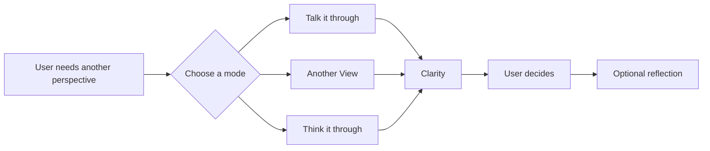
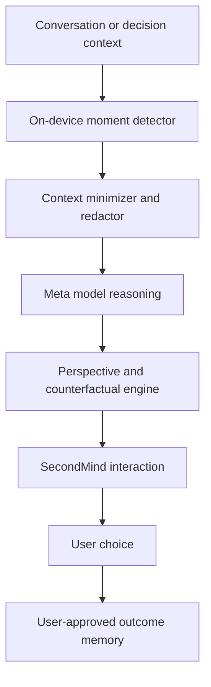

# SecondMind

### Your private thought partner inside Meta Muse

> **Talk it through. See another perspective. Decide with clarity.**

SecondMind is a context-aware AI thought partner for the everyday moments when another perspective would help. It listens when users need to talk, challenges assumptions without judging, compares options, and helps people reach decisions aligned with their own goals.

SecondMind is not a therapist, clinical service, or coach telling users what to do. It is a private sounding board—another mind in the room when the user feels stuck, uncertain, reactive, or simply wants to think more clearly.

## The problem

People rarely struggle because they have no information. They struggle because they are too close to the situation:

- “Am I interpreting this correctly?”
- “What might I be missing?”
- “Should I respond now or wait?”
- “Which option best supports what I actually want?”
- “I do not need advice yet—I just need to talk.”

Generic assistants answer isolated questions. Journaling apps require users to reconstruct the situation. SecondMind combines active listening, contextual understanding, alternative perspectives, and deliberate reasoning in one continuous relationship.

## What SecondMind offers

### Talk It Through

A judgment-free conversation that helps the user articulate what happened, what they feel, and what they need—without immediately forcing a solution.

### Another View

Offers plausible interpretations the user may not have considered. It distinguishes facts, assumptions, unknowns, and emotional conclusions.

### Challenge My Thinking

Respectfully tests an assumption, identifies possible cognitive biases, and asks the minimum number of questions needed to clarify the situation.

### Think It Through

Compares options, trade-offs, second-order effects, and alignment with the user's stated goals. The user remains the decision-maker.

### SecondLook

The hero hackathon workflow: a lightweight checkpoint before a consequential digital action, such as sending a reactive message or making a rushed commitment.

### Day in Perspective

An optional end-of-day reflection containing one positive choice, one pattern worth noticing, and one small intention selected by the user.

## How it feels in action

**User:** “My colleague dismissed my recommendation again. Maybe they do not respect me.”

**SecondMind:** “That sounds frustrating. Would it help to talk it through, see another interpretation, or decide how to respond?”

If the user chooses **Another View**, SecondMind shows:

- **Known:** The recommendation was not included.
- **Interpretation:** It was dismissed because your expertise is not respected.
- **Unknown:** Why a different decision was made.
- **Alternative view:** Timing, constraints, or missing context may have influenced the decision.
- **Useful next step:** Ask what criteria drove the decision before assigning intent.

SecondMind does not erase emotion or manufacture positivity. It creates enough distance for the user to choose deliberately.

## Hackathon demo: SecondLook

A user receives a dismissive workplace email and drafts an angry reply.

1. SecondMind detects potential escalation locally.
2. **SecondLook** offers a non-blocking pause before the message is sent.
3. The model separates facts, assumptions, unknowns, and desired outcome.
4. A counterfactual engine compares three response strategies.
5. The user selects an approach and receives an editable response.
6. SecondMind optionally follows up, learns the outcome, and saves only an insight approved by the user.

## Privacy by architecture

SecondMind is designed to understand context without building a permanent archive of private conversations.

- Context signals are processed on-device whenever possible.
- Raw conversations are transient and remain local by default.
- Only the minimum context required for a user-accepted request is sent for model reasoning.
- Other people's messages are not retained as personal profiles.
- Long-term memory stores only user-approved abstractions, such as goals, preferences, or strategies that worked.
- Users can inspect, edit, pause, or delete everything SecondMind remembers.
- SecondMind never sends, posts, purchases, or commits on the user's behalf.

## Technical concept

Core components:

- **Moment detector:** Identifies ambiguity, escalation, urgency, and consequential intent.
- **Conversation mode router:** Selects listening, alternative-view, challenge, decision, or reflection behavior.
- **Context minimizer:** Redacts unnecessary personal data and sends only relevant context.
- **System 2 reasoner:** Separates facts, assumptions, unknowns, biases, and goals.
- **Counterfactual engine:** Simulates plausible outcomes without claiming certainty.
- **Personal context memory:** Retains only user-approved values, preferences, and successful strategies.
- **Outcome evaluator:** Compares expected and reported outcomes to improve future reasoning.

## Ten-day MVP scope

The hackathon build demonstrates one complete **SecondLook** workflow while making the broader SecondMind experience visible in the prototype.

### In scope

- Talk through a situation using multi-turn conversation
- Ask for another interpretation or challenge an assumption
- Paste or select a message draft
- Detect likely escalation and decision significance
- Generate a System 1 → System 2 analysis
- Compare three response strategies
- Produce an editable response
- Record optional user feedback and outcome
- Demonstrate privacy and memory controls

### Not in scope

- Mental-health diagnosis or treatment
- Clinical, legal, or financial advice
- Autonomous sending or posting
- Continuous cloud recording of conversations
- Claims that the system can predict outcomes with certainty

## Success measures

- Users report greater clarity after a SecondMind interaction.
- Users discover at least one credible perspective they had not considered.
- Escalatory language decreases without weakening the user's intended message.
- Users understand and control what context and memory are retained.
- Predicted outcomes become better calibrated against user-reported results.

## Why SecondMind

Most AI assistants help people produce an answer faster. SecondMind helps them improve the thinking that comes before the answer.

**SecondMind gives every person a private sounding board—available whenever another perspective could change the outcome.**

